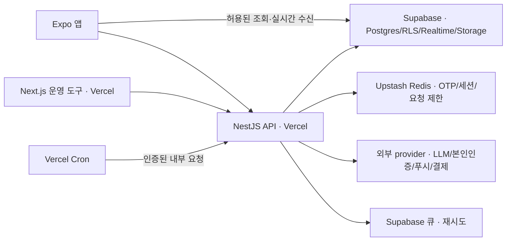

# 프롤로그 아키텍처 의사결정

갱신: 2026-10-30. 기존 파일명은 링크 호환을 위해 유지한다. 2026-05의 B안(NestJS + Supabase) 책임 분담은 유지하고, 호스팅·백그라운드·dev 환경은 [2026-10 멀티 서비스 플랫폼 결정](docs/superpowers/specs/2026-10-15-멀티서비스-플랫폼-design.md)으로 대체했다.

## 1. 확정된 결정과 현재 상태

| 항목                    | 결정                                                      | 현재 구현                                                          |
| ----------------------- | --------------------------------------------------------- | ------------------------------------------------------------------ |
| 책임 분담               | NestJS 비즈니스 API + Supabase DB·RLS·Storage·Realtime    | 유지                                                               |
| API·운영 도구 호스팅    | Vercel. Railway 계획 폐기                                 | API는 아직 `main.ts`의 `app.listen()`으로 실행. Vercel 전환 미완료 |
| 예약·응답 뒤 작업       | Vercel Cron·`waitUntil`                                   | NestJS `@Cron`·프로세스 내 비동기 실행                             |
| 재시도                  | Supabase 큐(pgmq) 또는 발송 대기표 + Cron                 | 연결 전. BullMQ 상시 워커를 전제로 하지 않음                       |
| 인증번호·세션·요청 제한 | Upstash Redis                                             | 현재 서버 메모리, 전환 필요                                        |
| 스키마·RLS 이력         | 목표는 `supabase/migrations` 통합                         | 현재 Prisma 마이그레이션 + `supabase/policies`·`pnpm db:rls`       |
| dev 환경                | 서비스 단계별. 출시 전 PR 미리보기, 출시 뒤 상시 dev 추가 | 프롤로그의 브랜치·연동 적용은 아직                                 |
| 모바일                  | Expo 앱·EAS 빌드, Expo Push                               | 앱 mock 화면·푸시 mock provider                                    |
| 본인인증                | 포트원 V2 통합본인인증, 업체는 견적 후 선택               | 기존 인터페이스·mock, 실 연동 전                                   |
| 공통 기능               | `platform` 패키지, 서비스별 키·DB·회원 유지               | 연결 전. 현황 조사·현황표 작성 계획만 폐기                         |

## 2. 결정 근거

### NestJS + Supabase를 유지하는 이유

인증·동의·갈피 대화·신고·차단·결제처럼 여러 규칙이 엮인 처리는 NestJS 한 곳에서 검증한다. Supabase는 Postgres·RLS·파일·실시간을 제공한다. 클라이언트의 직접 조회는 공개 범위가 확인된 데이터에만 허용한다.

### Vercel로 바꾼 이유

서비스별 상시 서버의 비용·운영 부담을 줄이고 기존 Vercel Pro·Supabase Pro 팀/조직을 이용한다. NestJS를 함수로 실행하고 예약은 Cron, 응답 뒤 작업은 `waitUntil`, 재시도는 DB 큐로 분리한다. 사용자 대화 수신은 Supabase Realtime이 맡아 API가 WebSocket 연결을 붙잡지 않는다.

Vercel 실행 한도를 넘는 작업은 나눈다. 긴 실행·고정 IP·상시 연결이 꼭 필요한 예외는 플랫폼 스펙 7장에서 판단한다. “NestJS는 Vercel에 맞지 않는다”거나 “본인인증 때문에 Railway가 필수다”라는 옛 결론을 현재 근거로 쓰지 않는다.

### 환경·비용

회원·데이터·키는 서비스마다 분리하고 공통 코드는 패키지로 공유한다. 출시 전과 운영 중의 dev 비용을 같게 가정하지 않는다. 환경 단계는 플랫폼 스펙 8.1, 비용은 15장으로 모은다. 과거 Railway 포함 월 $30~35 추산은 현재 예산이 아니다.

## 3. 현재 인증 경계

사용자 토큰은 NestJS `JwtIssuerService`가 `SUPABASE_JWT_SECRET`으로 발급하는 Supabase 호환 HS256 JWT이며 `SupabaseJwtStrategy`가 검증한다. 운영자는 별도 `ADMIN_JWT_SECRET`과 관리자 로그인 API를 쓴다. Supabase Auth가 모든 토큰을 발급한다는 옛 설명은 현재 구현과 다르다.

service role 키는 API에만 둔다. API는 RLS 우회를 전제로 사용자·소유권·동의를 직접 검증한다. 향후 Realtime 연결 전 토큰 신뢰와 정책을 확인한다.

## 4. 목표 시스템 구성도 (미적용 전환 포함)

이 그림은 배포 목표다. 현재 `ScheduleModule`과 `galpi.scheduler.ts`의 매시 먼저 말 걸기·10분 수집은 프로세스 내부에서 돈다. 전환과 DB 적용을 끝냈다는 뜻이 아니다.

## 5. 데이터 흐름

1. 단순 조회: 모바일 → Supabase. RLS와 컬럼 노출을 확인한 데이터만.
2. 비즈니스 처리·메시지 전송: 모바일/운영 도구 → NestJS → DB·외부 provider. 권한·차단·동의·상태 검증은 서버에서 한다.
3. 실시간 수신: Supabase Realtime → 모바일. 사람 대화 2단계에서 연결한다.
4. 백그라운드: 목표는 Vercel Cron·`waitUntil`·Supabase 큐. 현재는 NestJS 예약 작업이다.

옛 정기 추천 배치·추천 점수·대화 만료 처리를 예시로 되살리지 않는다. 좋은 상대가 나타났을 때만 소개하고 대화 성립에 과금한다([AGENTS](AGENTS.md) 1.1·12·13장).

## 6. RLS 설계 원칙

- 모든 애플리케이션 테이블에 RLS를 켠다. 직접 읽지 않는 테이블도 예외가 아니다.
- 실제 정책의 현재 기준은 `supabase/policies/*.sql`이다. 문서의 예시가 접근 권한을 새로 허가하지 않는다.
- 현재 `profiles`·`photos`는 자기 데이터·활성 매칭 관계를 정책으로 제한한다. 소개 테이블이 생기면 별도로 설계한다. 삭제된 `recommendations`·`user_actions`를 조회하는 정책을 만들지 않는다.
- 갈피 대화·서고·리포트·구조화 필드·LLM 사용량·푸시 토큰은 RLS만 켜고 클라이언트 정책을 두지 않는다. 허용된 열람·삭제는 NestJS DTO로 제공한다.
- 사용자·인증·동의·refresh token·관리자 테이블도 클라이언트 직접 접근을 열지 않는다.
- 행 수준 정책만으로 점수·넘긴 이유·신고 원문·운영 메모가 가려지지 않는다. 공개 DTO·view·컬럼 GRANT를 함께 검토한다.
- 모바일의 `messages`·`matches`·`reports`·`blocks` 직접 INSERT는 금지한다.
- RLS 변경에는 정책 검사와 실제 역할별 접근 거부 검증이 필요하다. 현재 파일 검사와 실제 DB 검증의 차이는 BACKLOG 1·9절에 남긴다.

현재 적용 순서는 **Prisma 마이그레이션 → `pnpm db:rls`**이며 원격 DB 적용에는 사람 확인이 필요하다. `supabase db push`가 현재 정책 디렉터리를 처리하지 않는다. [supabase/README](supabase/README.md)에 실제 위치·명령과 미래 통합 방향을 기록한다.

## 7. 변경 이력

- 2026-10-30: 2026-10 Vercel·Supabase 결정과 실제 코드를 반영했다. 목표/현재 구현, 인증, RLS·DB 적용, 공통 플랫폼 계획과 현황 조사 폐기 범위를 구분했다.
- 2026-05-10: B안(NestJS + Supabase 하이브리드) 채택. 당시 Railway·Supabase CLI 병행 적용 등의 내용은 이후 결정과 코드로 대체됐다. 원문은 Git 이력에서 확인한다.
