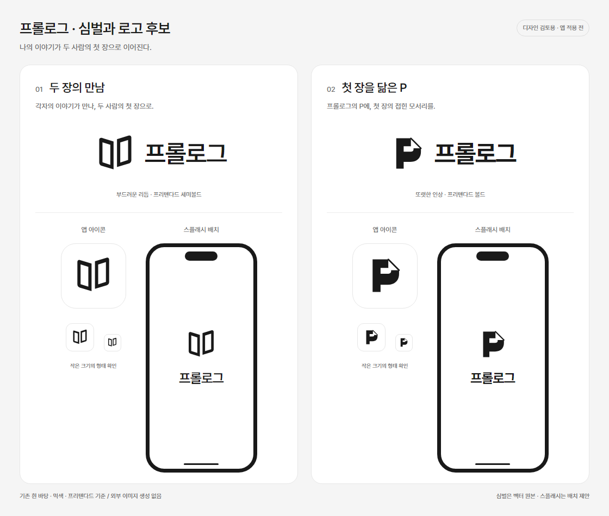

# 앱 아이콘과 로고 후보

상태 — 최신 진행은 영문 `Prologue` 글자 로고다. 운영자 요청으로 세 번째를 ‘모던하고 세련된 형태’로 바꿔 생성했다. 친근형과 모던형은 완료됐고 기본형은 실패했으며, 재시도는 제출하지 않았다. 아래 심벌 두 후보는 앞선 비교 자료이고 채택안은 미정이다. 앱 적용 완료를 뜻하지 않는다.

## 최신 진행 방향

운영자는 앞선 심벌 중 첫 번째가 그나마 낫지만 의도한 의미가 사용자에게 전달되기는 어렵겠다고 평가했다. 이후 텍스트 중심 로고를 의논했고, 한글 대신 영문 `Prologue`를 주안으로 탐색하기로 확인했다. 단정한 기본형·부드러운 친근형·모던하고 세련된 형태를 [전체 프롬프트와 생성 결과](../previews/brand/prologue-wordmark-brief.md)로 비교한다. 친근형과 모던형의 SVG를 확보해 철자·작은 크기·투명 배경을 렌더링으로 확인했다. 기본형은 실패했고, 실패 원인과 환급 여부는 확인하지 못했다. 추가 생성과 최종 채택은 운영자와 의논한다. 실제 앱에 적용할 최종 로고와 아이콘은 아직 정하지 않았다.

## 확인한 방향

- 온보딩 상세를 다시 정리하기 전에 앱 아이콘·로고·스플래시부터 다룬다.
- 중심 의미는 ‘나의 이야기가 두 사람의 첫 장으로 이어진다’다.
- 운영자가 ‘두 장이 만나는 모습’과 ‘첫 장을 닮은 P’를 검토할 방향으로 골랐다. 어느 안을 채택할지는 아직 정하지 않았다.
- 기존 흰 바탕·먹색·프리텐다드 기준을 따른다. 갈피의 책갈피 표식이나 캐릭터 설정을 바꾸지 않는다.

## 비교 자료와 원본

| 후보 | 형태 제안 | 한글 로고 제안 | 살펴볼 점 |
| --- | --- | --- | --- |
| 두 장의 만남 | 조금 다른 높이의 두 장이 서로를 향해 열린다. 가운데 여백은 함께 시작할 첫 장을 뜻한다. | 프리텐다드 세미볼드와 여유 있는 심벌·글자 배치 | 이야기와 관계의 시작을 떠올리게 하는지, 펼친 책의 인상이 얼마나 강한지 |
| 첫 장을 닮은 P | 접힌 종이 모서리와 프롤로그의 머리글자 P를 결합한다. | 프리텐다드 볼드와 간결한 심벌·글자 배치 | 작은 크기에서도 식별되는지, 프롤로그의 인상과 어울리는지 |

벡터 원본은 [두 장의 만남](../../apps/mobile/assets/brand/candidates/01-meeting-pages.svg)과 [첫 장을 닮은 P](../../apps/mobile/assets/brand/candidates/02-first-page-p.svg)다. 심벌 바탕은 투명하며 아이콘의 흰 바탕은 비교 자료에만 별도로 표현했다. 한글 로고는 기존 글꼴을 사용한 조합 제안이며 최종 글자 형태 확정 전이다.

외부 이미지 생성 모델을 호출하지 않고 SVG를 직접 설계했다. 비교 자료는 기존 앱의 글꼴과 SVG를 렌더링한 이미지다. 새 이미지 생성 비용은 없다. 실제 앱의 아이콘 등록·시작 설정과 화면은 이번 후보 제작에서 변경하지 않았다.

## 다음 의논

먼저 두 후보의 형태를 보고 남길 방향과 수정할 부분을 의논한다. 선택한 방향의 심벌·한글 로고를 다듬은 뒤 실제 앱의 아이콘과 스플래시에 연결한다. 온보딩 상세 검토는 그다음이다.
