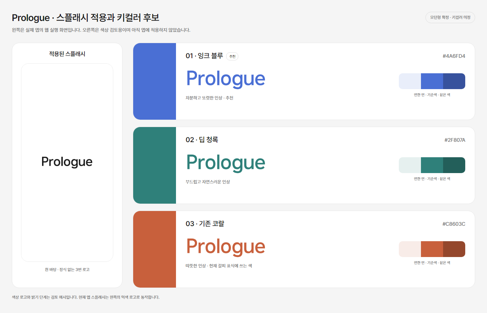

# Prologue 키컬러 검토

상태 — 운영자가 블루는 윌유와 겹치므로 후보에서 제외하고 코랄이 어울릴지 질문했다. 코랄은 현재 추천·검토 중이며 아직 확정하지 않았다. 전체 앱의 3번 모던형과 장식 없는 로고는 확정했고 기존 스플래시에 먹색으로 적용했다. 색상 토큰은 바꾸지 않았다.

아래는 블루 제외 결정 전의 비교 이미지다. 블루를 다시 선택하도록 제안하는 자료로 사용하지 않는다.

## 참고와 제안

운영자는 윌유를 참고 앱으로 들며 하늘색에서 파란 계열로 이어지는 사용을 언급했다. [윌유 공식 Google Play 소개](https://play.google.com/store/apps/details?hl=ko&id=com.lifeoasis.willu)의 아이콘과 소개 이미지에서도 하늘색 계열을 확인했다. 실제 설치 앱 내부를 조작한 확인이나 공식 브랜드 색상 코드 확인은 아니다. 아래 색상은 프롤로그를 위한 제안이다.

| 검토 경과 | 기준색 | 현재 상태 |
| --- | --- | --- |
| 블루 | `#4A6FD4` | 운영자 결정으로 제외 |
| 딥 청록 | `#2F807A` | 앞선 비교 대안 |
| 기존 코랄 — 현재 추천 | `#C8603C` | 운영자가 검토 중. 아직 확정하지 않음 |

블루를 제외한 조건에서는 청록보다 코랄을 추천한다. 정돈된 화면에 따뜻함을 더하고 갈피의 초록 카디건·코랄 책갈피와 색의 연결을 만들기 좋다는 판단이다. 현재 코랄은 밝은 분홍보다는 조금 짙고 차분한 색이다.

사용 범위 제안은 흰 바탕과 먹색 기본 틀을 유지하면서 로고·소수의 브랜드 강조에 코랄을 쓰고, 큰 버튼은 현행 먹색을 유지하는 것이다. 이는 추천이며 승인하거나 구현한 상태가 아니다. 갈피 캐릭터의 기존 색을 바꾸는 결정도 아니다. 현재 앱 스플래시는 먹색 로고·흰 바탕이다.

## 실제 반영과 확인

- [SVG 원본](../../../apps/mobile/assets/brand/prologue-wordmark.svg)과 [PNG 자산](../../../apps/mobile/assets/brand/prologue-wordmark.png)은 승인한 3번의 글자 경로를 그대로 유지한다. 여백만 정리해 PNG로 렌더링했다.
- [기존 스플래시](../../../apps/mobile/app/(auth)/a01-splash.tsx)에 해당 PNG를 적용했다. 로그인 처리와 기존 다음 화면 동선은 변경하지 않았다.
- [휴대폰 웹 실행 화면](2026-11-07-splash-phone.png)과 [PC 웹 실행 화면](2026-11-07-splash-desktop.png)에서 중앙 배치, 올바른 이미지 로딩과 온보딩 이동을 확인했다. 타입 검사도 통과했다.
- 실행 재확인 때 이전 서버가 닫혀 있어 Expo 앱 서버와 8090 휴대폰 프레임을 다시 실행했다. 현재 프레임은 8081 앱 루트를 연다.
- iOS·Android 실기기 빌드와 OS 시작 화면은 아직 확인하지 않았다. 이번 적용은 기존 앱의 A01 스플래시이며, 네이티브 시작 설정과 앱 아이콘 등록은 별도 과제다.
