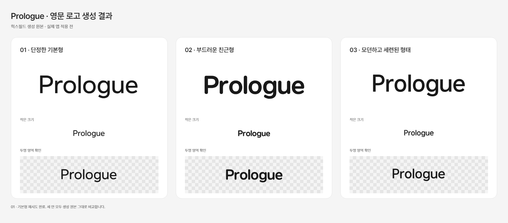

# Prologue 영문 로고 생성 구성안

상태 — 단정한 기본형·부드러운 친근형·모던하고 세련된 형태를 모두 확보했다. 세 번째는 운영자의 요청을 반영한 방향이다. 기본형은 첫 시도에 실패했고 운영자의 추가 승인으로 같은 조건에서 재시도해 완료했다. 최초 실패의 원인과 환급 여부는 도구 결과에서 확인하지 못했다. 실제 앱의 로고·아이콘·스플래시 적용은 결과 검토 뒤 진행한다.

후속 검토에서 워드마크 옆의 편지·비행기·종이 장식은 채택하지 않기로 했다. 현재는 아래 2번·3번을 기준으로 전체 앱의 인상을 먼저 정한다. [여섯 장식 배치 비교](prologue-wordmark-motion.md)는 미채택 기록이며 아래 글자 원본은 그대로 유지했다.

## 확보한 결과

- [단정한 기본형 SVG](../../../apps/mobile/assets/brand/wordmark-candidates/01-basic.svg)
- [부드러운 친근형 SVG](../../../apps/mobile/assets/brand/wordmark-candidates/02-friendly.svg)
- [모던하고 세련된 형태 SVG](../../../apps/mobile/assets/brand/wordmark-candidates/03-modern.svg)

세 원본 모두 투명 바탕의 먹색 벡터 경로이며 외부 글꼴이나 이미지에 의존하지 않는다. 실제 렌더링으로 `Prologue` 철자, 작은 크기와 투명 영역을 확인했다. 비교 이미지의 회색 격자는 투명 영역을 보여주기 위한 바탕이고 원본에 들어 있지 않다. 실제 앱의 시작 설정과 화면에는 아직 적용하지 않았다.

## 공통 설정

- 생성 서비스 — 힉스필드
- 모델 — GPT Image 2.6 (`gpt_image_2_6`)
- 후보 — 아래 방향별 하나
- 출력 — SVG, 투명 배경, 먹색 단색
- 품질 설정 — high, resolution 1k, aspect ratio 21:9
- 참조 이미지 — 사용하지 않음
- 글자 표기 — 정확히 `Prologue` (P만 대문자)
- 비용 — 저장소에 계정·비용 정보를 남기지 않고 대화에서 현재 견적을 확인한다.

## 실제 사용할 프롬프트

각 요청은 아래 공통 프롬프트 다음에 해당 방향의 문단을 붙인다.

### 공통 프롬프트

프롤로그는 '나의 이야기가 두 사람의 첫 장으로 이어진다'는 의미를 가진, 사적인 대화를 통해 나를 알아가고 한 사람씩 소개하는 성인 소개팅 서비스다. 정확히 "Prologue"라고 적힌 독창적인 영문 글자 로고 한 개를 디자인하라. P만 대문자이고 나머지는 소문자다. 앱 본문 글꼴인 Pretendard와 자연스럽게 어울리는 산세리프를 사용한다. 먹색 #191919 단색, 완전히 투명한 배경, 차분하고 편안하며 다정한 인상. 글자를 또렷하게 읽을 수 있고 작은 앱 화면에서도 균형이 좋아야 한다. 로고를 중앙에 놓고 사방에 충분한 여백을 둔다. 글자 자체가 주인공이다. 별도 심벌, 책·봉투·하트·사람 그림, 태그라인, 추가 문구, 시안 번호, 테두리, 목업, 그림자, 그라데이션, 입체 효과를 넣지 않는다. 모든 글자를 자체 완결된 벡터 경로로 표현하고 외부 글꼴이나 링크된 이미지에 의존하지 않는 SVG로 완성한다.

### 1. 단정한 기본형

이번 후보의 구체적인 방향: 중간 굵기의 현대적인 휴머니스트 산세리프. 글자 간격은 답답하지 않게 조정하고, 비례와 곡선의 균형에 집중한다. 반듯하고 안정적이면서도 모서리와 획 끝을 아주 조금 부드럽게 다듬는다. 장식적 변형보다 오래 쓸 수 있는 담백한 완성도를 우선한다.

### 2. 부드러운 친근형

이번 후보의 구체적인 방향: 조금 더 넓고 둥근 글자 형태와 부드러운 획 끝을 가진 맞춤형 산세리프. 처음 대화를 나누기 편한 친구처럼 따뜻하고 친근한 인상을 만든다. 둥근 o와 열려 있는 e의 형태를 살리고, 무겁지 않은 세미볼드 굵기를 사용한다. 어린이용이나 귀여운 캐릭터 글씨처럼 보이지 않게 성숙한 균형을 유지한다.

### 3. 모던하고 세련된 형태

이번 후보의 구체적인 방향: 모던하고 세련된 맞춤형 산세리프 워드마크. 정제된 비례, 절제된 획, 정확한 자간과 섬세한 광학 보정으로 완성도를 만든다. 지나치게 가늘지 않은 중간 굵기와 또렷한 실루엣을 사용하고, 전체 글자에 일관된 리듬을 준다. 특정 글자에 장식이나 상징을 강제로 넣지 않는다. 성숙하고 현대적인 인상을 내되 일상적인 소개팅 서비스에 어울리는 편안함을 유지한다.

## 검토할 내용

글자 철자·가독성·굵기·간격과 서비스의 차분하고 편안한 인상을 비교한다. 선택한 방향을 다듬은 뒤 아이콘과 스플래시에 연결한다. 이전 심벌 두 후보는 참고 자료로 남아 있으며 채택안은 미정이다.
