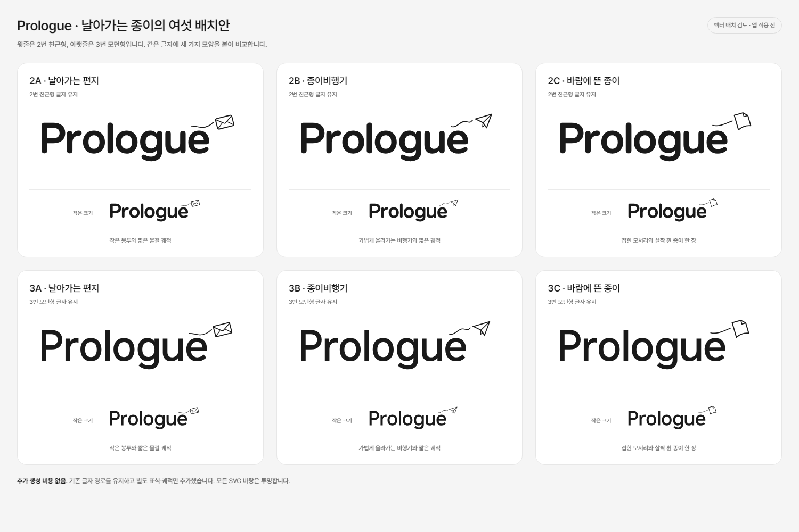

# Prologue 로고 — 종이 모티브 배치 비교

상태 — 미채택 기록. 운영자는 아래 배치 비교 뒤 워드마크에 장식이 없는 편이 낫다고 판단했다. 편지·종이비행기·종이 표식과 궤적을 더하는 안은 후속 선택에서 제외한다. 현재는 원래 2번 친근형·3번 모던형을 기준으로 전체 앱의 인상을 정하는 단계다. 아래 SVG는 앱에 적용하지 않은 비교 기록이다.

## 비교 이미지

| 배치 | 글자 기준 | 추가 모티브 | SVG 원본 |
| --- | --- | --- | --- |
| 2A | 친근형 | 작은 편지와 짧은 물결 궤적 | [2A](../../../apps/mobile/assets/brand/wordmark-studies/2a-letter.svg) |
| 2B | 친근형 | 종이비행기와 짧은 궤적 | [2B](../../../apps/mobile/assets/brand/wordmark-studies/2b-plane.svg) |
| 2C | 친근형 | 접힌 모서리와 살짝 휜 종이 | [2C](../../../apps/mobile/assets/brand/wordmark-studies/2c-page.svg) |
| 3A | 모던형 | 작은 편지와 짧은 물결 궤적 | [3A](../../../apps/mobile/assets/brand/wordmark-studies/3a-letter.svg) |
| 3B | 모던형 | 종이비행기와 짧은 궤적 | [3B](../../../apps/mobile/assets/brand/wordmark-studies/3b-plane.svg) |
| 3C | 모던형 | 접힌 모서리와 살짝 휜 종이 | [3C](../../../apps/mobile/assets/brand/wordmark-studies/3c-page.svg) |

## 작업 방식과 확인

- 기존 힉스필드 원본의 글자 경로를 그대로 사용했다. 공정하게 비교할 수 있게 대문자 높이를 맞춰 균등 확대·축소하고 위치만 조정했다.
- 표식과 궤적은 글자와 분리된 SVG 그룹이다. 글자 원본을 수정하거나 새로 생성하지 않았다.
- 새 힉스필드 호출은 없으며 추가 생성 비용도 없다. 움직임은 정적인 모양과 선으로 표현한 배치 제안이다.
- 모든 배치의 바탕은 투명하고 먹색 단색이다. 큰 크기와 작은 크기의 렌더링을 함께 확인했다.
- 실제 앱의 시작 설정과 온보딩 화면은 이번 작업에서 바꾸지 않았다.

재현 명령은 `node scripts/design/build-logo-motion.mjs`다. 이 명령은 후보 SVG와 목록만 만들며 기존 글자 원본이나 앱 설정을 수정하지 않는다.

## 다음 의논

이 모티브의 선택과 추가 발전을 다음 과제로 다시 제안하지 않는다. 현재는 원래 2번·3번 로고의 인상을 전체 앱에 어떻게 이어 갈지 의논한다. 최초 글자 후보와 생성 경과는 [영문 로고 구성안](prologue-wordmark-brief.md)을 참고한다.
