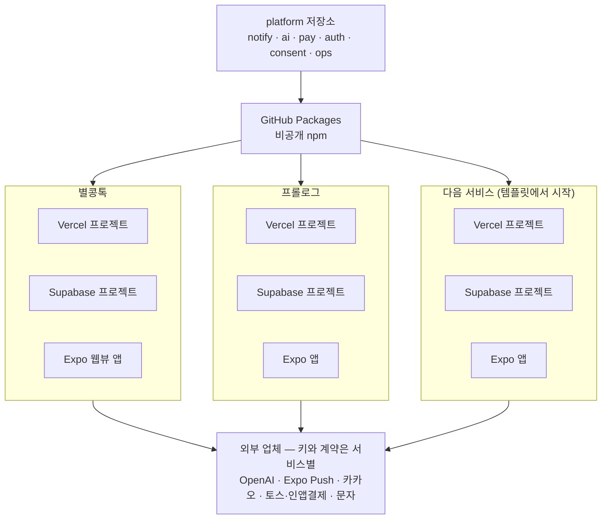
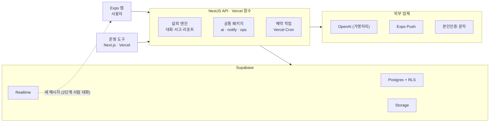
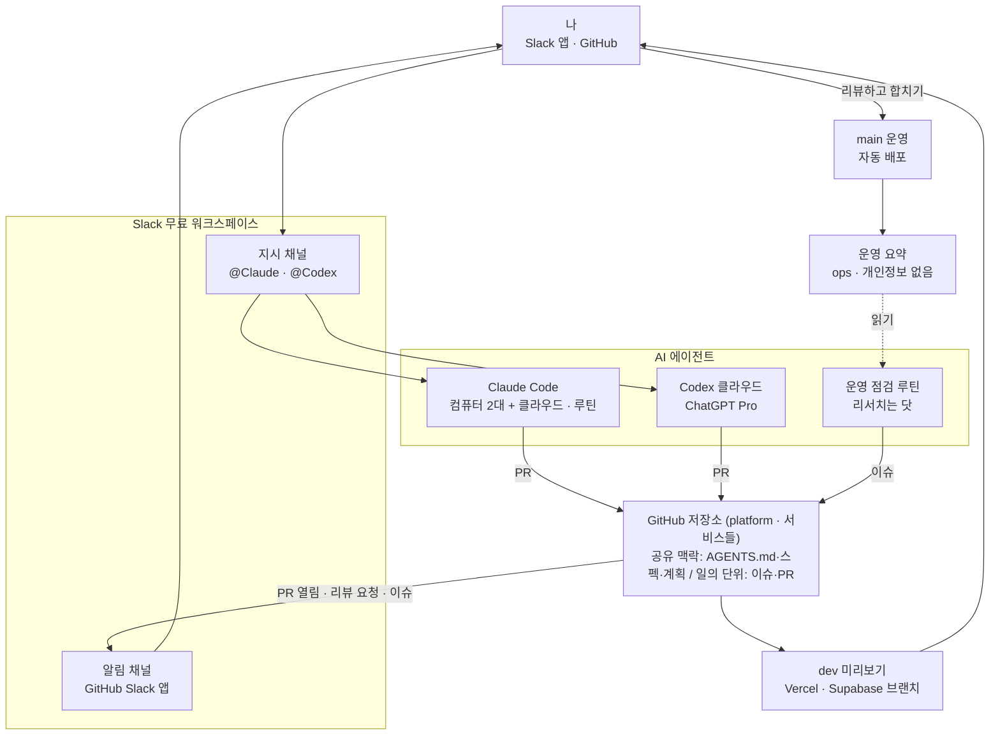

# 멀티 서비스 플랫폼 — 큰 지도 (v0.3)

- 작성: 2026-10-15
- 상태: 16장 결정 반영, 9장 에이전트 연동 보강(v0.3), 사용자 검토 대기
- 범위: 여러 서비스(별콩톡·프롤로그·앞으로의 서비스)가 함께 쓰는 공통 레이어, 저장소·계정·호스팅 구조, 개발·운영 환경
- 다음 스펙: ① 공통 알림 레이어(`notify`) 상세 ② 프롤로그 적용 — Railway 계획을 버리고 Vercel·Supabase 로, 공통 레이어 연결
- 이 문서는 `platform` 저장소가 생기면 그쪽으로 옮긴다. 그때까지 프롤로그 저장소에 둔다

---

## 0. 한 줄 요약

공통 기능은 `platform` 저장소에 패키지로 한 번 만들고, 각 서비스는 자기 저장소와 자기 Vercel·Supabase·Expo 프로젝트에서 그 패키지를 가져다 쓴다. 늘 켜진 서버(Railway)는 두지 않는다. 맥락은 저장소에 두고, 코드는 Claude Code 와 Codex 가 쓰고, 합치기는 사람이 한다.

## 1. 배경

| 항목 | 지금 |
|---|---|
| 별콩톡 | 운영 중. Next.js 16 + Supabase(서버에서 service role 로만 접근), Vercel 프로젝트 하나(main 운영 / dev 미리보기), Supabase 브랜치. Expo 웹뷰 앱으로 포장 중 |
| 프롤로그 | 개발 중. NestJS API + Expo 앱 + Next.js 운영 도구 + Supabase. 갈피 AI 엔진 1단계 완료 |
| 앞으로 | 서비스를 계속 만들어 런칭한다 |
| 계정 | Supabase·Vercel 유료 플랜을 이미 쓰고 있다 |
| 개발 방식 | Claude Code 데스크톱. 프롤로그와 별콩톡을 서로 다른 컴퓨터에서 개발한다. 앞으로 Claude Code·Codex 클라우드 세션으로 함께 작업한다 |

## 2. 목표와 성공 기준

1. 새 서비스를 띄울 때 알림·로그인·결제·AI 호출 같은 공통 기능을 다시 만들지 않는다
2. 서비스가 늘어도 월 고정비와 관리할 대시보드가 서비스 수만큼 늘지 않는다
3. 한 서비스의 사고(키 유출, 장애, 개인정보)가 다른 서비스로 번지지 않는다
4. 어느 컴퓨터, 어느 에이전트에서 시작해도 같은 맥락으로 일한다

**확정된 전제**
- 회원은 서비스마다 따로다. 공통 레이어는 데이터가 아니라 기능만 나눈다
- 앱은 모두 Expo 다. 푸시는 Expo Push 하나로 간다

## 3. 결정 요약

| 항목 | 결정 | 고르지 않은 것과 이유 |
|---|---|---|
| 공통 레이어 형태 | **공통 코드 묶음(패키지).** 실행·키·데이터는 서비스별 | 공통 서버: 그 서버가 멈추면 전부 멈추고, 모든 서비스의 푸시 토큰·전화번호가 한 DB 에 모인다. 한 저장소(모노레포): 운영 중인 별콩톡을 옮기는 비용이 크고, 한 곳이 깨지면 전부 영향을 받는다 |
| 호스팅 | **Vercel(API·예약 작업·웹) + Supabase(DB·실시간·파일).** 늘 켜진 서버는 없다 | Railway: 서비스마다 상시 서버 비용이 붙는다. 7장의 예외가 생긴 서비스만 상시 서버를 붙인다 |
| GitHub | **새 조직 계정 `braveshine-labs`** (브랜드 브레이브샤인). 패키지는 `@braveshine-labs/…`. 새 저장소부터 조직에 두고, 별콩톡·프롤로그는 나중에 옮길 수 있다 | 개인 계정: 나중에 조직으로 옮기면 모든 서비스의 패키지 이름(import)을 바꿔야 한다. `braveshine`·`brave-shine` 은 다른 사람의 개인 계정이라 쓸 수 없다 |
| Vercel·Supabase 계정 | **이미 쓰는 Vercel Pro 팀·Supabase Pro 조직에 두고, 프로젝트만 서비스별로.** 이름은 `braveshine-labs` 에 맞추고 사용량 상한·알림을 켠다 | 새 팀·조직: 월 $45 가 더 들고 대시보드가 둘. 서비스마다 따로: 서비스당 월 $45 이상 고정비. 어느 쪽이든 나중에 프로젝트를 옮길 수 있다 |
| 패키지 배포 | **GitHub Packages(비공개 npm).** 서비스는 버전을 고정해 쓰고, 새 버전이 나오면 Dependabot 이 서비스마다 업데이트 PR 을 연다 | — |
| 브랜치·dev 환경 | **main = 운영, dev = 미리보기. dev 는 서비스 단계별 (8.1):** 출시 전에는 운영 환경을 dev 처럼 쓰고 PR 마다 미리보기 DB, 출시하면 상시 dev 를 켠다 | 처음부터 서비스마다 상시 dev: 서비스당 월 약 $10 이 쉬는 서비스에도 나간다. 출시 뒤에도 PR 미리보기만: 운영 중인 서비스의 고정 QA 환경이 없어진다 |
| 맥락 | **저장소가 유일한 맥락.** 본문은 `AGENTS.md`, `CLAUDE.md` 는 `@AGENTS.md` 한 줄 | 컴퓨터별 메모리·대화 기록에 기대지 않는다 (10장) |
| 개발 에이전트 | **Claude Code(Claude Max 5x) + Codex(ChatGPT Pro)** | 직접 빌린 서버 + API 과금: 같은 작업량이면 훨씬 비싸다 (15장) |
| 지시·알림 창구 | **Slack 무료 워크스페이스 하나.** 지시는 `@Claude`·`@Codex`, 알림은 GitHub Slack 앱. 일의 단위와 기록은 GitHub 이슈·PR (9장) | 카카오톡: 지시를 받으려면 사업자 채널이 필요하고 '나에게 보내기'는 한 방향 알림. 텔레그램: Claude 쪽만, 내 컴퓨터에서 켜 둔 세션만. GitHub 에이전트 패널: 미리보기이고 Copilot 요금제로 따로 과금 |
| 에이전트끼리 일 넘기기 | **같은 회사 안은 하위 에이전트, 회사 사이는 서로의 PR 리뷰부터.** 새 일 넘기기는 필요해지면 GitHub Actions 로 잇는다 (9장) | 이슈 라벨·멘션만으로 깨우기: 지금 공식 기능으로 안 된다. API 로 지휘자 만들기(Claude Managed Agents): 구독 밖 API 과금 |
| 운영 에이전트 | **운영 점검은 Claude 루틴, 닷은 리서치·주간 요약으로 시범.** 조건이 되면 운영 감시를 닷으로 옮긴다 (9장) | 지금부터 닷 중심: 막 나온 기능이라 안정성이 확인되지 않았다. 둘이 나눠 감시: 중복·혼선. 그록 봇: 화면 조작에 계정 열쇠가 필요하고 베타다 |
| 본인인증 | **포트원 V2 통합본인인증.** 고정 IP 불필요(공식 문서 기준, 계약 때 재확인). 업체는 KG이니시스 통합인증과 다날 견적을 비교해 고른다 | NICE·KCB 직접 계약: 업체마다 계약·연동을 따로 해야 한다 |
| 앱 결제 | **앱은 인앱결제(애플·구글 소규모 개발자 프로그램 15%), 웹은 토스, 잔액은 하나** | 한국 대체결제: 26% + PG 약 3% 에 한국 전용 앱·직접 환불. 앱에서 팔지 않기: 애플 3.1.3(b) 로 심사 탈락 위험 |
| 제품 안 AI 공급자 | **11장 규칙을 통과한 곳만.** 지금은 OpenAI(주), Anthropic(보조) | Grok: 11장 참고 |
| 실시간 | **Supabase Realtime.** 서버가 연결을 붙잡지 않는다 | — |
| 음성통화 (프롤로그 2단계) | **음성통화 전용 SaaS** (LiveKit, Agora 등) | Vercel·Supabase·Railway 모두 음성 중계를 하지 않는다 |

## 4. 서비스 구조



- 서비스는 `platform` 패키지만 가져다 쓴다. 서비스끼리는 서로 참조하지 않는다
- 회원·데이터·업체 키는 서비스마다 따로다
- 새 서비스는 `service-template` 에서 시작한다. 공통 레이어가 처음부터 연결돼 있다

## 5. 공통 레이어 (`platform` 저장소의 패키지)

| 패키지 | 맡는 일 | 출발점 |
|---|---|---|
| `notify` 알림 | Expo 푸시를 먼저 만들고, 알림톡·문자·이메일은 필요할 때 더한다. 아래 공통 규칙 | 새로 만든다 |
| `ai` AI 호출 | 모델 어댑터(OpenAI·Anthropic·Gemini)와 폴백, 원가 기록, 프롬프트 캐시, 가명처리·민감정보 가리기, 위기 감지(규칙 + LLM 2차 판단), 평가 도구 | 별콩톡 `lib/claude`·`lib/sensitive` + 프롤로그의 가명처리·위기 감지 |
| `pay` 결제 | 토스(웹) 승인·취소와 오류 분류, 앱 인앱결제(애플·구글) 영수증 확인과 환불·취소 알림, 결제 기록, 같은 결제를 두 번 처리하지 않기. 인앱결제를 직접 만들지 RevenueCat 같은 SaaS 를 쓸지는 `pay` 스펙에서 정한다 | 별콩톡 `lib/toss` |
| `auth` 로그인 부품 | 카카오 로그인·연결 끊기·탈퇴, 서명된 세션 토큰, 휴대폰 인증, 본인인증 어댑터. 회원 데이터 자체는 서비스별 | 별콩톡 `lib/kakao` + 프롤로그 인증 |
| `consent` 동의 | 동의 종류(필수/선택/민감정보/국외이전/마케팅), 약관 버전, 철회 기록, 광고 수신 동의 2년 재확인 | 새로 만든다 |
| `ops` 운영 기본 | 오류 기록, 환경변수 점검, 상태 확인(`/health`), 표준 운영 요약(9장), KST 날짜 도구, 요청 제한(서버 메모리가 아니라 Redis) | 별콩톡 `lib/logger`·`lib/env` |

여기에 **서비스 시작 템플릿**(`service-template`)을 둔다. 위 패키지가 미리 연결된 새 서비스 뼈대다.

**`notify` 공통 규칙**
- 알림을 정보성과 광고성으로 나눈다
- 광고성은 수신 동의가 있어야 보내고, 밤 9시~아침 8시에는 따로 받은 동의가 없으면 막는다 (정보통신망법 50조)
- 서비스별 조용한 시간을 지킨다
- 보낸 기록을 남기고, 실패하면 다시 보내고, 만료된 푸시 토큰은 정리한다

**지금은 넣지 않는 것** (필요해질 때 더한다)
- 파일·이미지 처리
- 모든 서비스를 한 화면에서 보는 운영 대시보드
- 유입 추적 — 별콩톡 코드가 있으니 프롤로그 랜딩 페이지를 만들 때 판단한다

## 6. 패키지 설계 원칙 (초안 — 레이어별 스펙에서 확정)

1. **프레임워크 중립.** Next.js(별콩톡)와 NestJS(프롤로그) 둘 다에서 쓴다. Nest 모듈·Next 라우트 같은 틀에 묶인 부분은 얇은 연결부로만 둔다
2. **키와 DB 연결은 서비스가 넘긴다.** 패키지는 환경변수를 직접 읽지 않는다
3. **패키지가 쓰는 테이블은 SQL 마이그레이션과 RLS 정책 파일로 함께 준다.** 각 서비스 DB 에 같은 모양으로 생긴다
4. **외부 업체는 인터페이스 + 진짜/mock 스위치 + 운영에서 mock 금지.** 프롤로그 방식 그대로다
5. **개인정보.** 로그에는 식별자와 개수만 남기고, AI 로 보내는 데이터는 가명처리한다
6. **사용 설명서는 패키지 안에 둔다.** 서비스에 설치되면 함께 따라가서 클라우드 세션에서도 읽힌다
7. **버전 규칙.** 깨지는 변경은 메이저 버전을 올린다. 바뀐 패키지만 버전을 올린다
8. **테스트는 필수**이고 패키지 단위로 돈다

## 7. 런타임 아키텍처 (프롤로그 예시)



| 필요한 것 | 맡는 곳 |
|---|---|
| API (요청 처리) | Vercel 함수. NestJS 를 설정 없이 지원한다 |
| 예약 작업 | Vercel Cron — Pro 는 프로젝트당 100개, 1분 간격까지 (2026-01 공식 문서). Supabase `pg_cron` 도 대안 |
| 응답 뒤에 이어서 하는 일 | `waitUntil`·`after`, 최대 800초 |
| 실시간, 파일 | Supabase Realtime, Storage |
| 재시도가 필요한 일 (예: 알림 재발송) | Supabase 큐(pgmq), 또는 발송 대기표 + 예약 작업 |
| 요청 제한, 인증번호·본인인증 세션 | Redis(Upstash). 서버리스에서는 서버 메모리를 믿을 수 없다 |

**Vercel 로 부족한 경우** — 그 서비스만 상시 서버를 붙인다
- 800초(약 13분)를 넘는 긴 작업. 대부분은 잘게 나누면 해결된다
- 고정 IP 를 요구하는 업체(본인인증 업체 일부). Vercel 고정 IP 는 유료다
- 늘 연결된 서버(웹소켓 게임 서버처럼 Supabase Realtime 으로 안 되는 것)

## 8. 저장소와 계정

```
GitHub 조직 braveshine-labs
├─ platform            공통 패키지 (pnpm 모노레포). 서비스가 늘어도 크기는 공통 기능 수만큼만
├─ service-template    새 서비스 뼈대 (템플릿 저장소)
├─ byeolkongtalk       기존. 당분간 개인 계정에 두고 나중에 옮길 수 있다
├─ byeolkongtalk-app   새로 만든다. Expo 웹뷰 앱
├─ prologue            기존. 당분간 개인 계정에 두고 나중에 옮길 수 있다
└─ 서비스 N …
```

| SaaS | 구성 |
|---|---|
| GitHub 조직 (무료) | 서비스별 저장소 + `platform` + `service-template` |
| GitHub Packages | 공통 패키지. 조직 무료 저장 공간 500MB |
| Vercel Pro 팀 | 이미 쓰는 팀(이름을 braveshine-labs 로 맞춤). 서비스별 프로젝트, 운영 도구 포함. 사용량 상한·알림을 켠다 |
| Supabase Pro 조직 | 이미 쓰는 조직(같은 이름으로). 서비스별 프로젝트, 프로젝트마다 컴퓨트 약 $10/월. 사용량 한도는 조직 전체가 나눠 쓴다 |
| Expo 계정 | 앱별 프로젝트 |
| 외부 업체 | 서비스별(또는 사업자별) 계약과 키 |

**비밀값 규칙**
- 저장소에 두지 않는다. Vercel·Supabase·Expo 환경변수에만, 서비스마다·환경(운영/미리보기)마다 따로 둔다
- 공통으로 넣는 것은 패키지 읽기 토큰(`NPM_TOKEN`) 하나다. 각 서비스의 Vercel·Expo 빌드·GitHub Actions 에 넣는다

**저장소 이동 시 주의** — 별콩톡은 운영 중이라 조직으로 옮길 때 Vercel 의 Git 연결과 Supabase 브랜치 연결을 다시 걸어야 한다

### 8.1 dev 환경 — 서비스 단계별

dev 비용은 사실상 Supabase 에서만 생긴다. Vercel 의 dev 는 같은 프로젝트의 미리보기 배포라 따로 돈이 들지 않고, LLM 은 dev 에서 mock, Redis·결제는 무료 등급과 테스트 모드를 쓴다.

| 서비스 단계 | 구성 | dev 비용(월) |
|---|---|---|
| 아이디어·쉬는 중 | 아무것도 켜지 않는다 | $0 |
| 개발 중 (출시 전) | 운영 프로젝트 하나를 개발·QA 겸용(아직 사용자 없음). 변경은 PR 마다 Supabase 미리보기 브랜치 + Vercel 미리보기. 앱 QA 기간처럼 필요할 때만 상시 브랜치를 켰다 끈다 | PR 이 열린 시간만큼 (몇 달러) |
| 출시 후 (운영 중) | 운영 + 상시 dev 브랜치(고정 QA 주소, 테스트 결제·계정 유지) + PR 미리보기 브랜치. 지금 별콩톡과 같다 | 약 $10 + PR 몇 달러 |

- 미리보기 브랜치: PR 을 열면 생기고, 합치거나 닫으면 지워지고, 안 쓰면 멈춘다. 시드 파일로 테스트 계정을 채운다. Supabase 의 Vercel 연동이 PR 미리보기 배포에 그 DB 주소를 자동으로 넣는다. 시간당 약 $0.0134 이고 Supabase 지출 상한 밖이라 사용량 알림을 따로 켠다
- 출시 전 운영 주소가 상시로 열어 보는 주소다(앱 개발 빌드도 여기에 붙인다). 웹 프로젝트는 Vercel "모든 배포 보호"(Pro 포함)로 팀 멤버만 보게 하고, API 프로젝트는 앱이 불러야 하니 보호하지 않는다(우리 로그인이 있다)
- 출시할 때: 운영 DB 의 테스트 데이터를 비우고, 배포 보호를 기본값으로 돌리고, 상시 dev 브랜치를 켠다
- 브랜치는 `supabase/migrations` 에 있는 것만 적용한다. 그래서 서비스의 마이그레이션과 RLS 정책은 `supabase/migrations` 에 둔다

| 서비스 구성 | 처음부터 상시 dev 를 두면 | 단계별 |
|---|---|---|
| 운영 1 + 개발 1 (지금) | 약 $20 | 약 $10 + PR 몇 달러 |
| 운영 2 + 개발 2 | 약 $40 | 약 $20 + PR 몇 달러 |
| 운영 4 + 개발 3 + 쉬는 중 3 | 약 $100 | 약 $40 + PR 몇 달러 |

## 9. 개발·운영 환경



**에이전트 규칙**
- 에이전트는 이슈와 PR 까지만 만든다. 합치기는 사람만 한다
- 운영 콘솔(Vercel·Supabase·토스) 열쇠는 주지 않는다. 읽기 전용 운영 요약만 준다
- 결정은 에이전트의 기억이 아니라 저장소(이슈·문서)에 남긴다

**지시와 알림 — Slack 하나로**
- 지시: Slack 지시 채널에서 `@Claude` 또는 `@Codex`. 각자 저장소에 클라우드 작업을 시작하고 스레드에 진행과 결과를 올린다. 결과물은 PR 이다
  - Claude: "Claude Code in Slack"(Max 에서 된다). 채널에서만 부를 수 있고(DM 은 안 된다), GitHub 저장소만, 세션 하나에 PR 하나. 끝나면 나를 멘션하고 "PR 만들기" 버튼을 단다
  - Codex: 옛 "OpenAI Codex" Slack 앱(Plus·Pro). 결과를 스레드에 올리고, PR 은 작업 화면에서 직접 연다
- 이어서 지시하기: Codex 는 스레드에서 `@Codex` 를 다시 부르면 이어진다. Claude 는 스레드 답장으로 이어 가지 못하고 "세션 보기"로 웹·모바일 앱에서 이어 간다. 스레드로 이어 가는 Claude Tag 는 Team 요금제 이상이다
- 알림: Slack 에서 시작하지 않은 일(루틴, GitHub 에서 시작된 작업)은 스레드로 돌아오지 않는다. 그래서 GitHub Slack 앱이 PR 열림·리뷰 요청·이슈를 알림 채널로 보낸다. 누가 한 일이든 한곳에 모이고, 폰 알림은 Slack 앱으로 받는다
- Slack 무료 요금제(최근 90일 기록, 앱 10개)로 충분하다. 일의 기록은 GitHub 이슈·PR 에 남는다
- 쓰지 않는 것
  - 카카오톡: 지시를 받으려면 사업자 채널이 필요하고, '나에게 보내기'는 한 방향 알림이다
  - 텔레그램: Claude 쪽만 되고, 내 컴퓨터에서 켜 둔 세션에만 붙는다(미리보기 기능)
  - GitHub 에이전트 패널(이슈를 Claude·Codex·Copilot 에 배정): 미리보기이고, Max·Pro 가 아니라 Copilot 요금제로 따로 과금된다
- 위험: 옛 Codex Slack 앱은 새 `@ChatGPT` 앱(Business 이상)으로 바뀌는 중이라 언젠가 닫힐 수 있다. 닫히면 Codex 지시는 ChatGPT·Codex 앱이나 닷으로 옮긴다

**에이전트를 깨우는 방법 (트리거)** — 2026-10-17 공식 문서 기준

| 방법 | Claude (Max) | Codex (ChatGPT Pro) |
|---|---|---|
| 사람이 직접 | claude.ai/code, 데스크톱 앱, 모바일 앱 | ChatGPT·Codex 앱 |
| Slack | 채널에서 `@Claude` | 채널·스레드에서 `@Codex` |
| GitHub | 루틴의 GitHub 트리거 — **PR·릴리스 이벤트만** | PR 자동 리뷰(저장소마다 켬, P0·P1 만 짚음), 사람이 쓴 `@codex` 댓글 |
| 예약 | 루틴 예약 (1시간 이상 간격, 미리보기 기능) | 공식 예약 기능은 확인되지 않음 → 닷 또는 CI |
| 외부 호출 | 루틴 API (`/fire`, 토큰은 웹에서 발급) | `codex cloud exec`, Codex SDK, `openai/codex-action`(API 키 — 종량제) |

- **이슈에 라벨·멘션을 다는 것만으로는 에이전트를 깨울 수 없다.** Claude 루틴은 이슈 이벤트를 받지 않고, Codex 는 봇이 쓴 `@codex` 를 거절한다는 사용자 보고가 있다(공식 확인 없음)
- 필요해지면 GitHub Actions 로 잇는다. 이슈에 라벨이 붙으면 Actions 가 Claude 루틴 API 를 부르거나(구독 안), `codex-action` 을 돌린다(API 종량제)
- 루틴 한도: 계정당 예약 실행 시간당 100회, 루틴당 즉시·API 실행 시간당 30회, 계정당 API 실행 시간당 100회. 2026-04 출시 글은 하루 실행 횟수(Max 15회)를 적었으나 지금 문서에는 없다 — 쓰면서 확인한다

**에이전트끼리 일 넘기기**
- 같은 회사 안에서는 지금 된다
  - Claude: 역할 에이전트를 저장소의 `.claude/agents/*.md` 에 둔다(역할 설명·모델·도구·권한). 클라우드 세션도 이 파일을 읽는다(컴퓨터의 `~/.claude/agents` 는 읽지 않는다). 메인 세션이 이 에이전트들에게 일을 나눠 맡기고, 세션 하나 안에서 최대 20개가 동시에, 3단계까지 돈다
  - 세션 여러 개로 나눠 맡기는 Claude Projects(베타, 하루 200개)와 에이전트 팀(실험 기능, 토큰이 팀원 수만큼 는다)은 미리보기라 지켜본다
  - Codex: 하위 에이전트를 기본으로 지원한다. 닷은 Codex 클라우드 작업을 직접 시작할 수 있다
- 회사 사이에서는 리뷰는 되고, 새 일 넘기기는 잇는 일이 필요하다
  - 된다: 서로의 PR 리뷰. 저장소에 Codex 자동 PR 리뷰를 켜면 Claude 가 연 PR 도 Codex 가 본다. Claude 루틴은 PR 이벤트로 깨어 Codex 가 연 PR 을 리뷰한다
  - 잇는 일이 필요하다: 한쪽이 다른 쪽에 새 일을 맡기는 것. 위의 GitHub Actions 연결을 쓰거나, 운영자가 Slack 에서 한 번 부른다
  - Claude 가 Codex 를 도구로 부르던 `codex mcp-server` 는 2026-09-05 에 없어졌다. 지금은 셸에서 `codex exec`·`codex cloud exec` 를 부른다
  - API 로 지휘자를 직접 만드는 길(Claude Managed Agents)은 구독 밖 API 과금(토큰 + 세션 시간당 $0.08)이라 쓰지 않는다
- 누가 무엇을 맡을지(역할 나누기)는 16장 남은 질문 5

**운영 에이전트 운영 방식**
- 지금: 운영 점검은 Claude 루틴으로 하루 1~2회. 저장소를 직접 읽고 이슈를 연다
- 닷은 운영 콘솔 권한 없이 리서치·주간 요약(업체 가격 변화, 법 개정, 경쟁 동향)으로 시범 운영한다. 결과는 저장소 문서·이슈로 남긴다
- 운영 감시를 닷으로 옮기는 조건: 운영 중인 서비스 3개 이상, 루틴 실행 한도에 걸림, Slack 24시간 대화가 필요함 — 이 중 하나 + 이 계정에 닷이 열린 것 확인(Pro 100·200·500 에 순차 공개, 한국은 제외 대상이 아니다). 개인 Pro 의 닷이 내 Slack 에 붙는지는 문서에 없어 그때 확인한다

**운영 요약 표준** (`ops` 패키지)
- 서비스마다 같은 모양으로 돌려준다: 오류 수, AI 원가, 결제 실패, 알림 실패, 배포 상태
- 개인정보는 없고, 토큰이 있어야 읽힌다
- 에이전트가 여는 이슈는 같은 양식으로 쓴다: 서비스, 증상, 근거 수치, 제안

## 10. 맥락 관리 (두 컴퓨터와 클라우드)

**원칙: 저장소에 없는 맥락은 없는 것으로 친다.** 클라우드 세션은 저장소만 복제해서 시작한다.

| 맥락 | 있는 곳 | 할 일 |
|---|---|---|
| 규칙·스펙·계획·BACKLOG | 저장소 | 그대로 |
| 저장소 안 Claude 설정 (`.claude/`) | 저장소 | 그대로 |
| Claude 자동 메모리 | 각 컴퓨터 | 오래 갈 내용은 저장소 문서로 옮긴다 |
| 대화 기록 | 각 컴퓨터 | 중요한 결정은 스펙·계획·BACKLOG 에 남긴다 |
| 플러그인 (superpowers 등) | 각 컴퓨터 | 설치 목록을 문서로 남긴다 |
| 비밀값 (`.env`) | 각 컴퓨터 | 클라우드 환경 설정에는 개발용 키만 넣는다 |
| 커밋 안 한 파일 | 각 컴퓨터 | 커밋하거나 다른 곳에 보관할지 정한다 |

**옮기는 순서**
1. 프롤로그 컴퓨터: 메모리 중 문서에 없는 5개(제품 진행 방향, AI 느낌 디자인 금지, 이미지 생성 전 허락, 하위 에이전트 모델 제한, git 계정 설정)를 저장소 문서로 옮긴다. 갈피 엔진 1단계 결정 80개를 저장소에 남긴다 — **2026-10-15 끝**: `docs/context/운영자-작업-방식.md`, `docs/context/개발-환경.md`, `docs/superpowers/plans/2026-10-11-갈피-AI-엔진-1단계-결정.md`
2. 별콩톡 컴퓨터: 그 컴퓨터의 메모리를 검토해 `AGENTS.md`·docs 로 옮긴다. 붙여 넣을 요청문은 `docs/context/별콩톡-컴퓨터-맥락-정리-요청.md`
3. 운영자 작업 방식(한국어, 추천안 먼저, 이미지 생성 전 허락, 보안은 출시 전 점검 등)을 `platform` 저장소에 한 번 정리하고, 각 서비스 `AGENTS.md` 에는 요약을 둔다
4. 프롤로그도 별콩톡 방식으로 바꾼다 — 본문을 `AGENTS.md` 로 옮기고 `CLAUDE.md` 는 `@AGENTS.md` 한 줄

## 11. AI 공급자 규칙

사용자 데이터를 다루는 공급자는 아래를 모두 통과해야 `ai` 패키지에 들어간다.

1. 데이터 미학습·무보존 설정(또는 계약)을 확인했다
2. 처리방침에 수탁자와 국외이전을 고지했고, 동의 범위 안이다
3. 안전성을 확인했다 — 우리 평가 세트를 통과했고, 공개된 안전 평판과 규제 조사를 확인했다
4. 가명처리한 뒤 보낸다

사용자 데이터가 없는 운영자 개인 작업(리서치, 마케팅)은 이 규칙의 예외다.

**지금:** OpenAI(주), Anthropic(보조).

**Grok 은 쓰지 않는다.** 근거:
- 기업 약관상 개인정보는 무보존 API 로만 보내야 한다(제3자 사본 기준). 무보존을 켜면 일부 API 가 꺼지고, 한국 처리 지역이 없다
- EU 디지털서비스법 조사, 아일랜드 개인정보 감독기관 조사가 진행 중이고, 한국 개인정보보호위원회도 딥페이크 건으로 사전 점검에 들어갔다
- 안전 평판: Common Sense Media "허용할 수 없음", FLI AI 안전 지수 F, 2025~2026 성적 딥페이크 사건
- 2026-07 Grok Build 가 "학습 끄기" 상태에서도 Git 저장소를 비밀값까지 통째로 업로드한 사고가 있었다

## 12. 별콩톡에서 할 일

**A. 지금 고칠 것** (공통 레이어와 상관없이)
1. 로그인 쿠키(`byeolkong_user_id`)에 서명을 붙인다. 지금은 사용자 id 가 그대로라 id 가 새면 그 사람으로 로그인할 수 있다
2. AI 개인정보 처리를 정리한다. 처리방침에 OpenAI 를 수탁자·국외이전 대상으로 추가하고, 보낼 때 가명처리한다
3. 응답 뒤에 하는 일(위기 알림 기록, 사용량 기록, 요약)을 `waitUntil` 로 감싼다. 위기 알림은 안전 기능이라 특히 중요하다
4. 요청 제한을 Redis 로 옮긴다. 지금은 서버 메모리라 Vercel 인스턴스마다 따로 센다

**B. 앱 출시 준비** (Expo 웹뷰)
5. `byeolkongtalk-app` 저장소와 웹뷰↔앱 연결: 푸시 토큰 전달, 로그인 상태 공유, 알림을 누르면 해당 화면으로
6. 앱 결제: 앱은 애플·구글 인앱결제(소규모 개발자 프로그램 15% 를 신청), 웹은 지금처럼 토스, 별 잔액은 하나로 합친다. 웹뷰의 충전 버튼이 앱의 네이티브 결제를 부르게 연결하고, 서버는 영수증 확인·환불 알림·중복 방지를 한다(`pay`). 한국에서는 앱 안에서 웹이 더 싸다고 알리거나 링크를 걸 수 없다. 웹과 앱의 가격을 같게 할지는 16장
7. 알림 수신 동의와 마케팅 수신 동의 화면. 지금은 "시작하면 동의" 문구 하나뿐이다

**C. 공통 레이어로 옮기기** (`platform` 패키지가 생긴 뒤, 하나씩 dev 에서 검증)
8. AI: `lib/claude`·`lib/sensitive` → `ai`. 첫 버전을 별콩톡 코드에서 꺼내 만들기 때문에, 옮긴 뒤에도 별콩톡 동작은 그대로여야 한다
9. 결제(`lib/toss`), 로그인(`lib/kakao`·세션), 운영(`lib/logger`·`lib/env`) → 각 패키지
10. 알림(새로 만듦)과 동의 기록(새로 만듦)을 붙인다

## 13. 프롤로그에 미치는 것 (상세는 프롤로그 적용 스펙)

- **호스팅:** Railway 계획을 버리고 Vercel 로 간다
  - `@nestjs/schedule` 예약 작업 → Vercel Cron 이 부르는 내부 주소. 엔진의 예약 작업은 이미 서버 여러 대에서 동시에 돌아도 안전하게 짜여 있다
  - 응답 뒤 작업(첫 리포트 쓰기, 수집) → `waitUntil`
  - 요청 제한·인증번호·본인인증 세션 → Redis
- **공통 레이어 연결:** 푸시 → `notify`. LLM 호출·가명처리·위기 감지 → `ai` (프롤로그 구현이 출발점 중 하나)
- **실시간:** 2단계 사람 대화는 보내기는 NestJS, 받기는 Supabase Realtime (CLAUDE.md 4장 패턴 3). Realtime 의 RLS 가 우리 로그인 토큰을 믿도록 맞춘다
- **맥락:** `CLAUDE.md` 본문을 `AGENTS.md` 로 옮긴다
- **본인인증:** 포트원 V2. 앱(웹뷰)에서 포트원 SDK 로 인증하고, 서버가 `api.portone.io` 에서 결과를 API 시크릿으로 조회한다. 이름·생년월일은 확인 뒤 버리고 DI 로 1인 1계정을 확인한다(CLAUDE.md 10.1). 계약 신청에 개인정보처리방침 주소가 필요하다
- **dev:** 출시 전 단계다(8.1). Prisma 마이그레이션과 `db:rls` 스크립트로 적용하던 RLS 정책을 `supabase/migrations` 로 합친다. Prisma 는 클라이언트와 SQL 생성에만 쓴다
- **결제:** 연결권도 앱 안에서 쓰는 디지털 재화라 인앱결제를 쓴다
- **문서:** `CLAUDE.md` 2장, `09_아키텍처_의사결정_v0_2.md`, `DEVELOPMENT_SPEC.md` 의 Railway 를 고친다

## 14. 로드맵

| 단계 | 할 일 |
|---|---|
| 0 (지금) | 별콩톡 12장 A, 프롤로그 컴퓨터 맥락 옮기기(10장 1), GitHub 조직 `braveshine-labs` 만들기, Vercel 팀·Supabase 조직 이름 맞추기, 포트원에 본인인증 견적 요청(KG이니시스 통합인증·다날), Slack 지휘실(워크스페이스에 Claude·Codex·GitHub 앱 연결, 저장소에 Codex 자동 PR 리뷰 켜기 — 9장) |
| 1 | `platform` 저장소 + `ops` + `notify`(Expo 푸시). 별콩톡 앱과 프롤로그 둘 다 푸시가 필요하다 |
| 2 | `ai` — 별콩톡에서 꺼내 만들고, 별콩톡이 먼저 갈아탄 뒤 프롤로그가 따라온다 |
| 3 | `consent`, `pay`(앱 결제 결정 뒤), `auth` |
| 4 | `service-template` |

프롤로그 적용 스펙(Vercel 이전)은 1단계와 나란히 진행한다.

## 15. 비용 (월, 2026-10 조사 기준 — 결제 전 확인)

| 항목 | 비용 |
|---|---|
| Claude Max 5x | $100 + 부가세 (달러 결제, 약 ₩15~16만) |
| ChatGPT Pro | ₩159,000 (원화 결제, 블로그·커뮤니티 기준). 닷은 Pro 100·200·500 에 순차 공개 |
| Vercel Pro | 이미 결제 중 (좌석 $20 + 사용량) |
| Supabase Pro | 이미 결제 중 + 서비스 프로젝트당 약 $10 |
| dev 환경 | 운영 중인 서비스만 상시 dev 약 $10, 출시 전 서비스는 PR 미리보기 몇 달러 (8.1) |
| 본인인증 | 건당 과금 또는 월정액 — 견적 필요 (예전 공개 단가 KG이니시스 통합인증 약 40원/건) |
| 앱 결제 수수료 | 인앱결제 15% (소규모 개발자 프로그램), 웹 토스 약 3.4% |
| GitHub 조직 | 무료 |
| Redis (Upstash) | 무료 범위에서 시작 |
| Expo 빌드 | 요금 확인 필요 |
| 운영 에이전트 | Claude 루틴은 구독에 포함 |
| Slack | 무료 요금제 (최근 90일 기록, 앱 10개) |
| 에이전트 연결 (필요할 때) | GitHub Actions 무료 분량 안. `codex-action` 을 쓰면 OpenAI API 종량제 |

**비교로 검토한 것**
- 직접 빌린 서버 + 구독 로그인: 위 금액 + 서버 (AWS 서울 4코어/16GB 24시간 약 $181, 평일 근무시간만 약 $60). 두 컴퓨터 맥락 문제가 계속 불편하거나 Docker·로컬 DB 를 상시로 띄워야 할 때 작게 더한다
- 직접 빌린 서버 + API 과금: 가볍게 써도 월 $130~290, 하위 에이전트를 많이 돌리면 월 $1,000 이상 → 개발용으로는 쓰지 않는다
- GPU + 오픈 모델: H100 한 장 24시간 월 $1,450~2,900 → 지금 단계에는 맞지 않는다

## 16. 결정 기록과 남은 질문

**결정 (2026-10-15)**
1. GitHub 조직 이름: `braveshine-labs` (`braveshine`·`brave-shine` 은 다른 사람 계정)
2. Vercel·Supabase: 이미 쓰는 Pro 팀·조직에 두고 프로젝트만 서비스별로. 이름은 `braveshine-labs` 에 맞춘다
3. 별콩톡 앱 결제: 인앱결제(소규모 15%) + 웹 토스, 잔액 하나
4. 본인인증: 포트원 V2, 고정 IP 불필요(계약 때 재확인), 업체는 견적 비교
5. dev: 서비스 단계별 (8.1)
6. 운영 에이전트: 루틴으로 시작, 조건이 되면 닷으로 (9장)

**남은 질문**
1. 본인인증 업체 최종 선택 — KG이니시스 통합인증(사용자가 PASS·카카오·네이버 선택) vs 다날(휴대폰). 견적과 DI 제공 여부로 정한다
2. 인앱결제를 직접 만들지, RevenueCat 같은 SaaS 를 쓸지 (`pay` 스펙)
3. 별콩톡 앱 가격을 웹과 같게 할지, 앱을 조금 비싸게 할지
4. Vercel 팀·Supabase 조직 이름을 바꾸는 시점 — 운영 중인 별콩톡에 영향이 없는지 확인한 뒤
5. Claude·Codex 역할 나누기 — 누가 무엇을 맡고 누가 검토하나. 추천안 검토 중 (2026-10-17)
6. AGENTS.md 구성 — 별콩톡 AGENTS.md 는 지금 쓰는 에이전트를 위한 것이라 새 구조에 맞춰 새로 만들어야 한다(운영자, 2026-10-17). 프롤로그의 AGENTS.md 전환(10장 4단계)과 같이 정한다. Codex 는 `CLAUDE.md` 가 아니라 `AGENTS.md` 를 읽으므로, 프롤로그에 Codex 를 쓰기 전에 정해야 한다

## 17. 근거 자료 (2026-10 조사)

- Vercel: [NestJS on Vercel](https://vercel.com/docs/frameworks/backend/nestjs), [Limits](https://vercel.com/docs/limits), [Cron usage and pricing](https://vercel.com/docs/cron-jobs/usage-and-pricing), [Static IPs](https://vercel.com/docs/networking/static-ips.md), [Hobby 플랜 비상업 제한](https://vercel.com/docs/plans/hobby)
- Supabase 요금: [Makerkit 정리](https://makerkit.dev/blog/saas/supabase-pricing)
- Claude: [요금](https://claude.com/pricing), [루틴](https://code.claude.com/docs/en/routines), [Claude Code on the web](https://code.claude.com/docs/en/claude-code-on-the-web)
- OpenAI: [Codex cloud](https://learn.chatgpt.com/codex/cloud), [Codex in Slack](https://developers.openai.com/codex/integrations/slack), [Codex GitHub](https://developers.openai.com/codex/integrations/github), [Dots](https://learn.chatgpt.com/codex/dots)
- xAI: [X Subscription](https://x.ai/news/x-subscription), [API 보안 FAQ](https://docs.x.ai/developers/faq/security), [Grok Build 업로드 사고](https://thehackernews.com/2026/07/grok-build-uploads-entire-git.html), [Common Sense Media 평가](https://www.commonsensemedia.org/ai-ratings/grok)
- GitHub 요금: [Costbench 정리](https://costbench.com/software/developer-tools/github/)
- 포트원: [본인인증 V2 가이드](https://developers.portone.io/opi/ko/extra/identity-verification/readme-v2?v=v2), [V2 웹훅(IP 안내)](https://developers.portone.io/opi/ko/integration/webhook/readme-v2?v=v2), [헬프센터 휴대폰 본인인증](https://help.portone.io/content/cellphone-identity-verification), [문서 원본 저장소](https://github.com/portone-io/developers.portone.io)
- Supabase: [Branching](https://supabase.com/docs/guides/deployment/branching), [Branching 연동(Vercel)](https://supabase.com/docs/guides/deployment/branching/integrations), [프로젝트 이전](https://supabase.com/docs/guides/platform/project-transfer), [조직 단위 과금](https://supabase.com/docs/guides/platform/billing-on-supabase.md)
- Vercel: [배포 보호](https://vercel.com/docs/deployment-protection), [프로젝트 이전](https://vercel.com/docs/projects/transferring-projects)
- 에이전트 연동 (2026-10-17 조사)
  - Claude: [Claude Code in Slack](https://code.claude.com/docs/en/slack), [Claude Tag](https://claude.com/docs/claude-tag/overview), [채널(텔레그램 등)](https://code.claude.com/docs/en/channels), [하위 에이전트](https://code.claude.com/docs/en/sub-agents), [에이전트 팀](https://code.claude.com/docs/en/agent-teams), [Projects](https://code.claude.com/docs/en/claude-projects), [Managed Agents 요금](https://platform.claude.com/docs/en/about-claude/pricing), [루틴 출시 글](https://claude.com/blog/introducing-routines-in-claude-code)
  - OpenAI: [Slack 의 OpenAI Codex 앱](https://slack.com/marketplace/A09F5C369E3-openai-codex), [Codex 하위 에이전트](https://learn.chatgpt.com/docs/agent-configuration/subagents), [Codex 변경 기록(mcp-server 제거)](https://learn.chatgpt.com/docs/changelog), [Codex GitHub](https://learn.chatgpt.com/docs/third-party/github), [codex-action](https://github.com/openai/codex-action), [닷](https://learn.chatgpt.com/docs/dots)
  - GitHub: [서드파티 코딩 에이전트](https://docs.github.com/en/copilot/concepts/agents/about-third-party-coding-agents), [Claude·Codex 를 Copilot 에서(2026-02-26)](https://github.blog/changelog/2026-02-26-claude-and-codex-now-available-for-copilot-business-pro-users/)
  - 메신저: [Slack 무료 요금제 제한](https://slack.com/help/articles/27204752526611-Feature-limitations-on-the-free-version-of-Slack), [카카오톡 메시지 API](https://developers.kakao.com/docs/latest/ko/kakaotalk-message/common), [텔레그램 봇 FAQ](https://core.telegram.org/bots/faq)
- 앱 결제: [애플 앱 심사 지침](https://developer.apple.com/app-store/review/guidelines/), [한국 StoreKit 외부 결제](https://developer.apple.com/jp/support/storekit-external-entitlement-kr/)

## 18. 변경 이력

- 2026-10-17: v0.3. 9장에 "지시와 알림 — Slack 하나로"와 "에이전트끼리 일 넘기기"를 더하고, 트리거 표를 2026-10-17 공식 문서로 고침 — Claude 루틴은 이슈 이벤트를 받지 않고(PR·릴리스만) Codex 는 봇의 멘션을 거절해서, 이슈 라벨·멘션만으로는 에이전트를 깨울 수 없다. `codex mcp-server` 제거 반영. 3장 결정 두 줄, 14장 0단계 Slack 연결, 15장 비용, 16장 남은 질문 둘(역할 나누기, AGENTS.md), 17장 출처
- 2026-10-15: v0.2 보충. 10장 1단계 끝 표시, 2단계 요청문 연결(내용 변경 없음)
- 2026-10-15: v0.2. 16장 결정 여섯 개 반영 — GitHub 조직 `braveshine-labs`, 기존 Vercel·Supabase 팀·조직 사용, dev 는 서비스 단계별(8.1 신설), 본인인증은 포트원 V2(고정 IP 불필요), 앱 결제는 인앱결제 15% + 웹 토스, 운영 에이전트는 루틴에서 조건부로 닷. 남은 질문 네 개
- 2026-10-15: v0.1. 큰 지도 — 공통 코드 묶음(패키지), Vercel + Supabase(Railway 없음), GitHub 조직, 저장소 구성, 공통 레이어 6개 + 템플릿, 패키지 설계 원칙(초안), 런타임 아키텍처, 개발·운영 환경과 트리거, 맥락 관리, AI 공급자 규칙, 별콩톡 할 일, 프롤로그 영향, 로드맵, 비용
